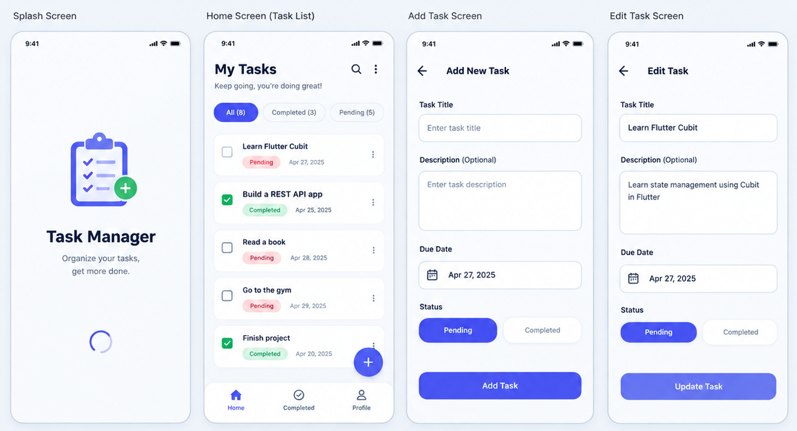

# MiniTodo 📝

**MiniTodo** is a Flutter-based task management application designed to help users organize and track their daily tasks through a simple and intuitive interface.

The app uses **SQLite** for local data persistence and **Cubit** for state management, providing a structured approach to handling task operations and updating the UI.

## ✨ Features

- **Task Management:** Create, view, update, and delete tasks.
- **Local Data Persistence:** Store tasks locally using SQLite with `sqflite`.
- **Task Filtering:** Filter tasks by All, Completed, and Pending.
- **State Management:** Manage application states using Flutter Bloc and Cubit.
- **Task Status Tracking:** Mark tasks as completed or pending.
- **Offline Support:** Access locally stored tasks without requiring an internet connection.

## 🛠️ Tech Stack

- **Flutter** — Cross-platform application development.
- **Dart** — Programming language.
- **Cubit / Flutter Bloc** — State management.
- **SQLite / sqflite** — Local database and persistent storage.

## 🎯 Project Goals

MiniTodo was built as a practical project to strengthen my Flutter development skills, particularly in state management, local database integration, CRUD operations, and application architecture.

## 🚀 Getting Started

1. Clone this repository.
2. Install the dependencies:
   ```bash
   flutter pub get
   ```
3. Run the application:
   ```bash
   flutter run
   ```
## 📱 App Preview

<p align="center">
  
</p>

## 👨‍💻 Author

**Mohamed Anis**

Flutter Developer | Software Engineer
